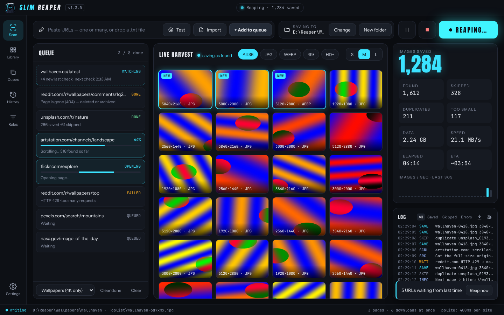
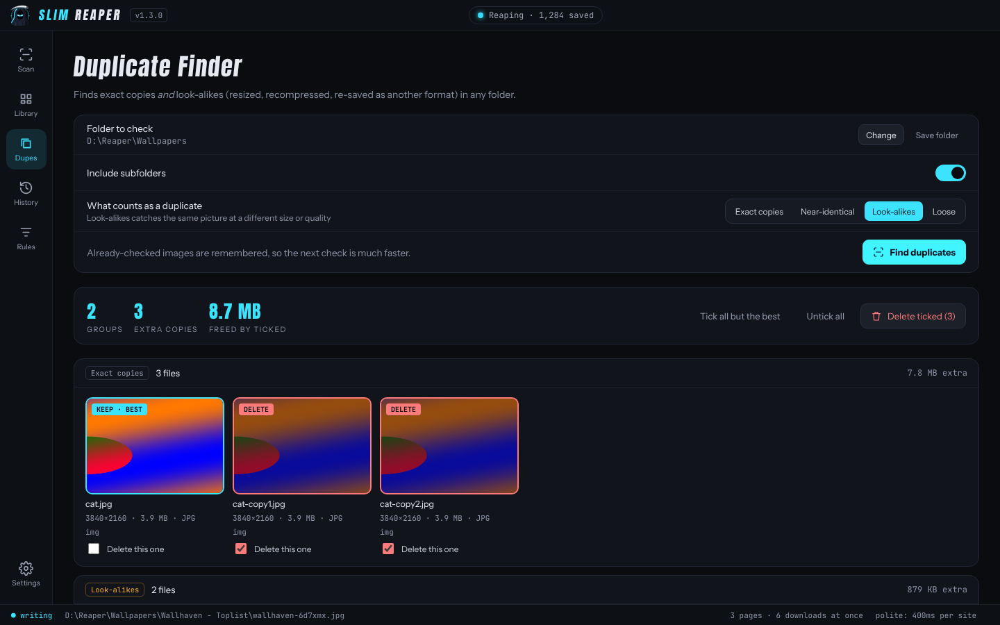
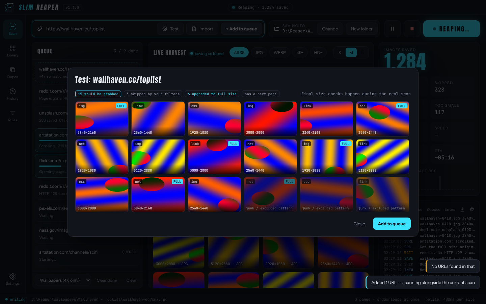

<h1 align="center">Slim Reaper</h1>

<b>Point it at a page. It takes every image.</b> 
A free image grabber for Windows 10 / 11 by <b>Slim Industries</b>.

<a href="../../releases/latest"><b>⬇ Download the latest version</b></a>

---

Paste a link — a gallery, a thread, a subreddit, a wallpaper site — and Slim Reaper opens it in a real
(hidden) browser, scrolls through it, clicks "Load more", follows "Next page", and saves every proper
image to your folder **the moment it finds it**. Thumbnails, icons, logos and ads are skipped, full-size
originals are grabbed instead of previews, and duplicates never get saved twice.

## Download & run

1. Go to **[Releases](../../releases/latest)** and download one of these:
   - **`SlimReaper-Setup-x.x.x.exe`** — installs like a normal program (Start menu + desktop shortcut)
   - **`SlimReaper-Portable-x.x.x.exe`** — one file, no install, run it from anywhere
2. Windows may say **"Windows protected your PC"** because the app isn't code-signed (that costs money
   indie developers usually skip). Click **More info → Run anyway**.
3. Paste a URL, press Enter. Images land in **Pictures\Slim Reaper**, one folder per page or thread.

Nothing to set up, no account, everything stays on your PC.

  
  

## New in 1.5

- **Nothing is remembered.** History, thumbnails and the duplicate memory last only until you close the app. Only your settings are saved.
- **Removing never deletes files.** Remove an image or a scan inside Slim Reaper and it just leaves the app; the file stays in File Explorer.
- **Library tab removed.** Browse your folders in File Explorer; History has an **Open folder** button for each scan.
- **Clear** button on the History page empties it in one click.
- Re-scanning a thread still skips images already in its folder.

## New in 1.3
- **Several scans at once**: add a URL while something is running and it scans side by side (3 pages at once by
  default — change in Rules → Speed)
- **Paste and go**: adding a URL starts it immediately (Settings → When I add a URL)
- **Watch several threads at once**, each on its own timer, even while other scans run
- Optional **"Watch every thread I add"** for forum, image-board and Reddit threads (off by default)

## New in 1.2
- **One folder per page / thread**, named cleanly: `Wallhaven - Toplist`, `Reddit - r-wallpapers - …`,
  `Unsplash - Nature`. Next pages of the same URL go in the same folder. (Rules → Saving → Folders to change it.)
- **Deleted images are forgotten automatically** — delete them anywhere and scanning again brings them back.
  No more "Forget all".
- **"Nothing new"** message when everything's already saved, with a **Download again anyway** button
- Clear log reasons: "already in your folder", "same image twice in this scan", "look-alike of one you already have"
- **Watch a thread**: right-click a URL → Watch for new images. Re-checks every few minutes, grabs only new
  images, stops by itself when the thread dies
- **Dead pages**: deleted/archived threads show **GONE** instead of an error
- **Click a URL in the queue** to show only its images · folder button / right-click → Open its folder
- **Rename a folder** from History (no File Explorer needed)
- Simpler Duplicates rules: just "Skip images you already have" and "Skip look-alikes"

## New in 1.1
- **Duplicate Finder** (Dupes tab): checks any folder for exact copies *and* look-alikes (resized, recompressed,
  re-saved as PNG/WEBP), shows them side by side, ticks every copy except the best, deletes to the Recycle Bin
- **Photos-only by default**: skips anything under 400×400 or 10 KB, plus logos, icons, avatars, ads, banners
  (edit the junk list in Rules → URL filters; the "Everything" preset turns it off)
- **Big-site boosters**: full-size originals on Reddit, Imgur, Pinterest, X/Twitter, Tumblr, Flickr, ArtStation,
  DeviantArt, Wallhaven, Wikipedia and image boards
- **No more double saves** on thread/gallery sites: when a preview links to its full image, only the full one is kept
- **Live sync**: delete images in File Explorer and they vanish from the app within seconds
- **Select many images**: Ctrl/Shift-click or Ctrl+A → copy, move, remove from app, copy paths
- **Drag images out** of the app into Discord, chats or folders
- **Test a URL** before scanning: see what would be grabbed, nothing downloaded
- **Folders**: right-click a URL → save it to its own folder · new folder per scan · auto-sort by
  landscape/portrait, resolution or format
- **Safety limits**: stop after X images or X MB, and stop automatically when the drive is nearly full
- **Report a problem** (bug icon in the log, or Settings → About): saves one file to send for help
- Small thumbnails for smooth scrolling, faster scan starts on big folders
- Fixes: app now fully quits when closed, Copy URL no longer re-adds itself with clipboard watching,
  Start with Windows works with the portable .exe, cut-off scans no longer show as "running" forever

## What it does

**Grabbing**
- Opens each page in a real (hidden) Chrome browser, so script-built galleries, lazy-loading and infinite scroll all work
- Auto-scrolls, clicks "Load more" buttons, follows "Next page" links, and can follow links 1–2 levels deep
- Finds `` tags, the largest `srcset` version, lazy-load attributes, `<picture>` sources, CSS backgrounds,
  full-size images behind thumbnails, anything the page downloaded, share-preview images, video posters,
  inline SVGs, embedded data images and favicons (each one switchable)
- **Smart full-size**: tries the original of resized copies first (WordPress `-300x200`, CDN `?w=` params)
- URL rewrite rules for sites with their own thumbnail → original patterns
- URL ranges: `site.com/page/[1-20]`, `[01-50]`, `[0-100:10]`
- Dismisses common cookie banners so they don't block scrolling

**Saving — as they're found**
- Every image is written to your folder the second it's found, not at the end
- Folder layouts: one folder / per URL / per site / site + date / page title
- File name patterns: `{original} {site} {date} {time} {n} {n:3} {wxh} {title} {alt} {page} {hash}`
- Rename / skip / overwrite on name clashes, fixes wrong extensions, keeps the server's original file date
- Optional WEBP/AVIF → JPG/PNG conversion and a `.json` info file next to each image

**Filters**
- Min/max width & height, min/max file size, file types, orientation, aspect ratio, max images per URL
- Only/never grab URLs matching wildcards or regex, blocked sites list ("Never grab from here")
- Exact duplicates (fingerprint), **near-duplicates** (visual match catches resized/recompressed copies),
  files already in your folder, and everything you've ever reaped before

**Speed & safety**
- Pages and downloads in parallel, per-site delay, automatic back-off on "too many requests",
  retries, bandwidth cap, optional robots.txt respect, custom browser identity, headers, proxy
- **Sign-ins**: log into a site once in Settings → Sign-ins and scans can see what you can see

**The app**
- Live image wall with format/size filters, live stats, speed graph, ETA and log
- Pause / resume / stop / skip a URL / retry, queue survives restarts
- Full image viewer: zoom, pan, filmstrip, palette, open, show in folder, copy image/URL, set as wallpaper, remove from app
- Scan History for the current session with open folder, re-run, rename and CSV reports
- Presets (7 built in + your own), scheduled re-scans, clipboard watching, drag & drop URLs or .txt lists
- Tray icon with pause/stop, Windows notifications, taskbar progress, sound, start with Windows
- Accent colors: Ice, Toxic, Violet, Blood, Gold

## Keyboard shortcuts
| | |
|---|---|
| Start | Ctrl + Enter |
| Pause / resume | Space |
| Stop | Ctrl + Shift + X |
| Paste URLs | Ctrl + V (anywhere) |
| Import list | Ctrl + O |
| Pages | Ctrl + 1–5, Ctrl + , |
| Select images | Ctrl/Shift + click, Ctrl + A, Delete |
| Viewer | ← → · wheel/+/− zoom · 0 fit · 1 actual size · Delete |

## Where things live
- Your settings: `%APPDATA%\Slim Reaper` (nothing else is kept between runs)
- Default save folder: `Pictures\Slim Reaper` (change it any time)

Images belong to their creators — reap for personal use and check a site's terms before reposting.

© Slim Industries · slimindustries.apps@gmail.com

## Build it yourself
Install [Node.js LTS](https://nodejs.org), then double-click **`run.bat`** to run it or **`build.bat`** to make the
.exe files (they appear in `dist`). New releases on this page are built automatically by GitHub Actions
(`.github/workflows/release.yml`) whenever a Release is published.

Fonts: Anton, Instrument Sans and JetBrains Mono, under the SIL Open Font License (see `src/renderer/assets/fonts`).
